# On-the-fly irreps generation from solvable group chain

This page describes an algorithm to generate irreps for solvable groups [Neto, 1973](../../references.md#Neto:a09740).

## Subduced and induced representations for solvable group

Let $H$ be invariant subgroup of $G$ such that $G/H = \mathbb{Z}_{p}$ ($p$ is prime and $r^{p}=e$),

$$
\begin{aligned}
G = \coprod_{m=0}^{p-1} r^{m} H.
\end{aligned}
\tag{1}
$$

Consider projective irrep $\Delta$ with factor system $\mu$ for $H$,

$$
\begin{aligned}
S \psi_{j} = \sum_{i=1}^{d} \psi_{i} \Delta(S)_{ij} \quad (R \in H, i = 1, \dots, d).
\end{aligned}
$$

The following representations are also irrep over $H$:

$$
\begin{aligned}
\mathbf{\Delta}^{(m)}(S)
  &:= \frac{ \mu(S, r^{m}) }{ \mu(r^{m}, S_{m}) } \mathbf{\Delta}(S_{m})
  \quad (S \in H, m = 0, \dots, p-1) \\
S_{m}
  &:= r^{-m} S r^{m} (\in H)
\end{aligned}
$$

There are two cases for $\{ \Delta^{(m)} \}_{m=0, \dots, p-1}$:

1. They are mutually inequivalent: $\Delta \uparrow G \downarrow H \cong \sum_{m=0}^{p-1} \Delta^{(m)}$

2. They are all equivalent: $\Delta \uparrow G \downarrow H \cong p \Delta$

### Case-1: conjugated irreps are mutually inequivalent

For case-1, the induced representation $\Delta \uparrow G$ is irrep [^footnote1] [^footnote2]:

$$
\begin{aligned}
\Delta \uparrow G (r^{m} S)_{i:, j:}
  &= \mathbb{I}[i \equiv j + m] \frac{ \mu(r^{m}S, r^{j}) }{ \mu(r^{i}, S_{j} ) } \mathbf{\Delta}( S_{j} )
  \quad (S \in H).\\
\Delta \uparrow G (S)
  &= \begin{pmatrix}
    \mathbf{\Delta}^{(0)}(S) & & & \\
    & \mathbf{\Delta}^{(1)}(S) & & \\
    & & \ddots & \\
    & & & \mathbf{\Delta}^{(p-1)}(S)
  \end{pmatrix}
  \quad (S \in H) \\
\Delta \uparrow G (r)
  &= \begin{pmatrix}
    \mathbf{0} & \mathbf{0} & \mathbf{0} & \cdots & \mathbf{0} & \frac{\mu(r, r^{p-1})}{\mu(E,E)} \mathbf{1} \\
    \frac{\mu(r, E)}{\mu(r,E)} \mathbf{1} & \mathbf{0} & \mathbf{0} & \cdots & \mathbf{0} & \mathbf{0} \\
    \mathbf{0} & \frac{\mu(r, r)}{\mu(r^{2},E)} \mathbf{1} & \mathbf{0} & \cdots & \mathbf{0} & \mathbf{0} \\
    \vdots     & \vdots     & \vdots     &        & \vdots     & \vdots \\
    \mathbf{0} & \mathbf{0} & \mathbf{0} & \cdots & \frac{\mu(r, r^{p-2})}{\mu(r^{p-1},E)} \mathbf{1} & \mathbf{0}
  \end{pmatrix}.
\end{aligned}
$$

[^footnote1]: This follows from Frobenius reciprocity theorem. In this case, $\Delta$ appears only once in $\Gamma \downarrow H$.
Thus, $\Gamma$ appears only once in $\Delta \uparrow G$.

[^footnote2]: We can choose factor system to satisfy $\mu(E, R) = \mu(R, E) = 1 (\forall R \in G)$, and then $\Delta^{(0)} = \Delta$

### Case-2: conjugated irreps are equivalent

For case-2, the induced representation $\Delta \uparrow G$ is reducible.
Let one of intertwiner between $\Delta^{(0)}$ and $\Delta^{(1)}$ be $\mathbf{U}$,

$$
\begin{aligned}
\mathbf{\Delta}^{(0)}(S) \mathbf{U} = \mathbf{U} \mathbf{\Delta}^{(1)}(S)
\quad (\forall S \in H).
\end{aligned}
$$

See [this page](intertwiner.md#intertwiner) for numerical way to obtain $\mathbf{U}$.
We scale $\mathbf{U}$ such that $\mathbf{U}^{p} = \mathbf{1}$.

The induced representation $\Delta \uparrow G$ is decomposed to $p$ irreps $\{ \Delta_{q} \}_{q=0}^{p-1}$,

$$
\begin{aligned}
\mathbf{\Delta}_{q}(S) &= \mathbf{\Delta}(S) \quad (S \in H) \\
\mathbf{\Delta}_{q}(r) &= \frac{1}{\omega_{q}} \mathbf{U}.
\end{aligned}
$$

The coefficient $\omega_{q} \, (q = 0, \cdots, p - 1)$ is determined as follows:

$$
\begin{aligned}
\mu(E, E) \mathbf{1}
  &= \mathbf{\Delta}_{q}(E) \\
  &= \mathbf{\Delta}_{q}(r^{p}) \\
  &= \frac{1}{ \prod_{m=1}^{p-1} \mu(r, r^{m}) } \mathbf{\Delta}_{q}(r)^{p} \\
  &= \frac{1}{ \prod_{m=1}^{p-1} \mu(r, r^{m}) } \frac{1}{\omega_{q}^{p}} \mathbf{1}
    \quad (\because \mathbf{U}^{p} = \mathbf{1}) \\
\therefore \omega_{q}
  &:= \frac{1}{ \left( \mu(E, E) \prod_{m=1}^{p-1} \mu(r, r^{m}) \right)^{\frac{1}{p}} }
      \exp \left( \frac{2 \pi i q}{p} \right).
\end{aligned}
$$

## Decomposition of crystallographic point groups

A crystallographic point group $G$ can always be decomposed as Eq. [(1)](#decomp) because it is a solvable group.
spgrep adapts the following decomposition [Aroyo, 2016](../../references.md#ITA2016):

